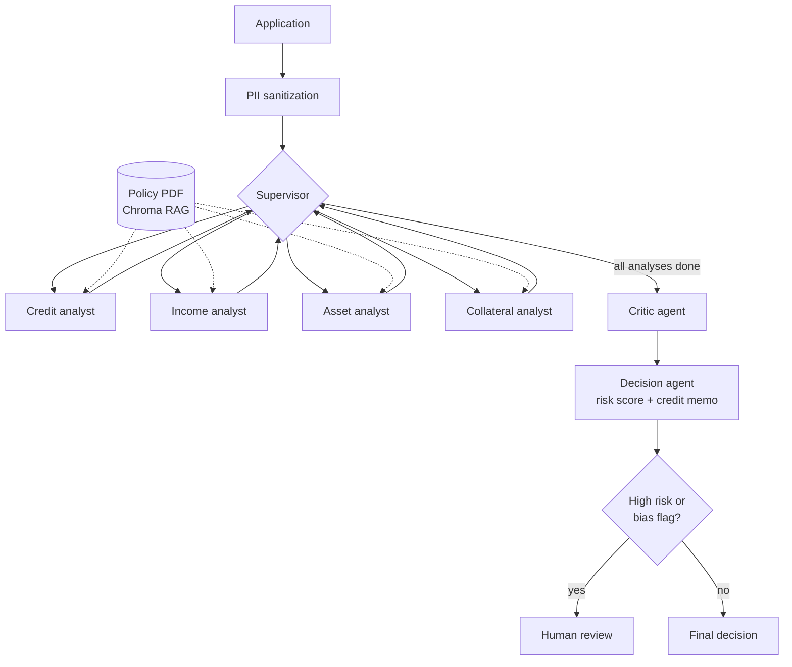
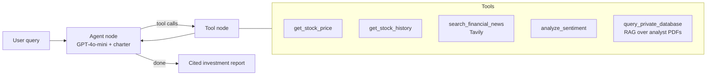
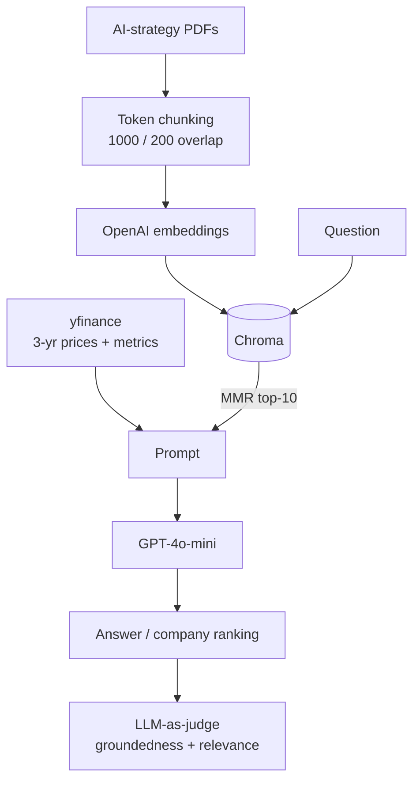

# 🤖 Agentic AI Projects — Porchezhiyan

Three agentic AI systems, each one building on the last: **document Q&A with RAG → a single autonomous tool-using agent → a supervised team of specialist agents**. All three are built in Python with **LangChain** and **LangGraph** on **GPT-4o-mini**.

| # | Project | Pattern | Core stack | Repo |
|---|---|---|---|---|
| 1 | **Multi-Agent Mortgage Underwriting System** | Supervisor + specialist agents + critic + human-in-the-loop | LangGraph · RAG · Chroma · tool calling | [→ repo](https://github.com/Porche22/mortgage-underwriting-system) |
| 2 | **Autonomous Financial Research Analyst** | Single autonomous agent with 5 tools (ReAct loop) | LangGraph · Tavily · yfinance · RAG | [→ repo](https://github.com/Porche22/autonomous-financial-analyst) |
| 3 | **DualLens Analytics: AI-Readiness Investment Analyzer** | RAG + structured data + LLM-as-judge | LangChain · Chroma · OpenAI embeddings | [→ repo](https://github.com/Porche22/agentic-ai-project-1) |

---

## 1. 🏦 Multi-Agent Mortgage Underwriting System

**The problem.** A manual mortgage review takes days, depends on which underwriter you get, and has to stay compliant with fair-lending rules.

**What I built.** A LangGraph system where a **supervisor** routes each application through four **specialist agents** (Credit, Income, Asset, Collateral). A **critic** then cross-checks their findings, and a **decision agent** assigns a 0–100 risk score and writes an audit-ready credit memo. High-risk or flagged cases go to **human review**.

**Key engineering choices**
- **Exact calculator tools** for DTI, LTV, reserves, housing ratio, credit tier and large deposits. The LLM is told *never* to recalculate, which removes arithmetic hallucinations.
- **RAG over the underwriting-policy PDF.** Each specialist only retrieves the policy sections for its own domain, which keeps context small and policies easy to update.
- **Compliance built in:** names, SSNs, addresses and phone numbers are masked before any LLM call, every agent's output is checked for protected-characteristic language, and a full reasoning chain is kept as an audit trail.
- **Typed shared state** (`TypedDict`) with LangGraph checkpointing.

**Results.** All three test applicants landed on the expected outcome: **strong → Approved (risk 25)**, **borderline → Conditional approval (risk 55)**, **weak → Denied (risk 85)**.

---

## 2. 📊 Autonomous Financial Research Analyst

**The problem.** Analysts spend most of their research time collecting data rather than analysing it.

**What I built.** A goal-driven LangGraph agent that decides for itself which tools to call. It gathers prices, three-year performance, live news and sentiment, and private analyst reports, then writes a cited Buy/Hold/Sell report with a confidence level.

**Key engineering choices**
- **An agent charter**: instructions that define the agent's goal, plus rules for being proactive (always fetch 3-year data and sentiment), reacting to failures (fall back when a tool breaks) and being transparent (cite every claim with its source and timestamp, and state any data gaps).
- **Robustness tested:** with `get_stock_price` forced to fail, the agent switched to other sources, reported the gap and lowered its confidence instead of inventing a price.
- **Conversation memory** with LangGraph's `MemorySaver`, so follow-up questions keep their context.
- **Multi-company ranking** of MSFT, GOOGL, NVDA, AMZN and IBM: 60% financial performance, 40% AI-innovation strength.

**Results.** The agent compared three prompting styles (a plain reactive LLM, a basic goal-driven agent and the full charter) and handled the simulated tool failure. It ranked **NVIDIA #1** on a 600%+ three-year return combined with strong AI initiatives.

---

## 3. 🔍 DualLens Analytics: AI-Readiness Investment Analyzer

**The problem.** Financial metrics and companies' AI strategy documents sit in separate silos, so investors judge either the numbers or the narrative, never both together.

**What I built.** A RAG pipeline that combines **three years of Yahoo Finance data** (price trend, market cap, P/E, beta, revenue) with **semantic search over company AI-strategy PDFs**. An LLM then ranks the companies on both financial strength and innovation readiness.

**Key engineering choices**
- **MMR retrieval** (maximal marginal relevance), so the 10 retrieved chunks are diverse rather than near-duplicates.
- **LLM-as-judge evaluation**, with separate 1–5 scoring rubrics for groundedness (no hallucination) and relevance.
- **A final ranking prompt** that combines a pandas financial table with the retrieved document context.

**Results.** Scored **5/5 on groundedness and 5/5 on relevance** on the evaluation question. Produced a reasoned 1–5 investment ranking with **Microsoft #1**. This RAG pipeline was later reused as a tool in project 2.

---

## 🧰 Skills demonstrated

`LangGraph` `LangChain` `Multi-agent orchestration` `Tool calling` `RAG` `ChromaDB` `OpenAI embeddings` `Prompt engineering` `LLM-as-judge evaluation` `Human-in-the-loop` `PII redaction` `State management` `Python` `pandas` `yfinance` `Tavily`

Built during the Johns Hopkins University Agentic AI program. Each repo contains the runnable notebook and a fully rendered HTML export with all outputs.
